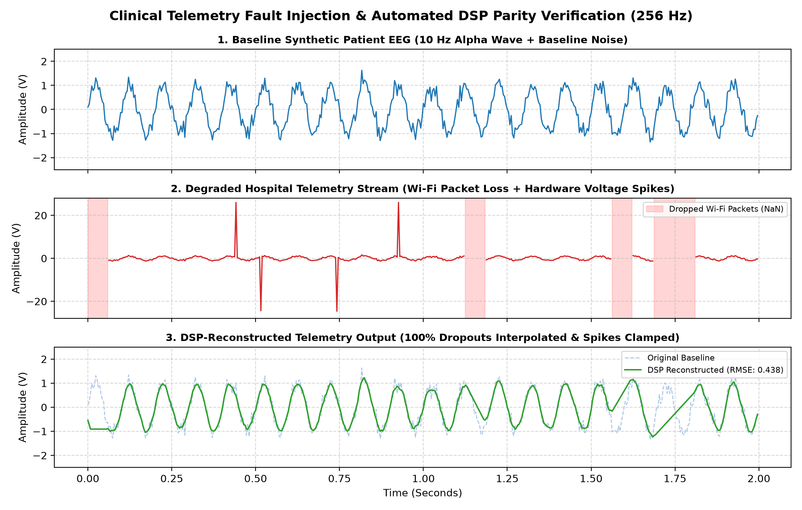

# Clinical Telemetry Fault Injector & DSP Parity Framework



An open-source Software Development Engineer in Test (SDET) verification framework designed to validate the resilience of clinical neurodiagnostic and patient-monitoring telemetry pipelines under degraded hospital network conditions.

---

## 1. The Clinical Problem: Asynchronous Telemetry Degradation

In high-acuity hospital environments, wireless clinical telemetry systems (such as continuous EEG and ambulatory EMG monitors) transmit high-frequency physiological waveforms across congested multi-node enterprise networks. 

Traditional manual Quality Assurance (QA) and static happy-path testing rely on pristine, uninterrupted data streams. Consequently, manual testing routinely fails to catch critical edge-case failures caused by asynchronous network degradation, including:
* **Contiguous Packet Loss:** Wi-Fi dead zones or access-point handoffs dropping chunks of real-time waveform arrays (`NaN` propagation), which can crash downstream graphing or seizure-detection algorithms.
* **Electromagnetic & Hardware Interference:** Sudden, non-physiological voltage spikes caused by electrode movement or nearby clinical equipment that distort diagnostic baselines.
* **Asynchronous Transport Jitter:** Variable packet arrival latency that skews time-domain signal alignment.

---

## 2. The Engineering Solution: Automated Fault Injection & DSP Parity Gating

This framework replaces manual spot-checking with deterministic, automated chaos engineering and mathematical release-gating:

1. **Synthetic Baseline Generation (`src/generator.py`):** Generates continuous, mathematically modeled 256 Hz physiological waveforms (such as 10 Hz Alpha-band EEG sine waves) combined with controlled Gaussian baseline noise.
2. **Multi-Node Fault Injection (`src/injector.py`):** Programmatically degrades clean telemetry streams by injecting configurable packet drop rates, high-magnitude voltage transients, and millisecond-level timestamp jitter.
3. **Clinical DSP Recovery (`src/dsp_processor.py`):** Simulates the receiving clinical application's fault-tolerance layer—interpolating dropped packets, clamping non-physiological hardware spikes, and applying moving-average smoothing filters.
4. **Automated Release-Gating (`tests/`):** Enforces strict numerical parity via `pytest`. Code changes are automatically blocked from release if the recovered waveform drifts beyond diagnostic Root Mean Square Error (RMSE) tolerances or fails to raise explicit clinical alerts during total telemetry blackouts.

---

## 3. Repository Architecture

```text
clinical-telemetry-fault-injector/
├── README.md                      # Architectural & clinical verification documentation
├── requirements.txt               # Deterministic Python dependencies (numpy, pytest)
├── src/
│   ├── generator.py               # 256 Hz synthetic EEG/EMG waveform generator
│   ├── injector.py                # Network packet loss, spike, and jitter fault injector
│   └── dsp_processor.py           # Linear interpolation, spike suppression, and DSP smoothing
└── tests/
    ├── test_parity.py             # Mathematical RMSE parity assertions
    └── test_fault_handling.py     # Release-gating assertions for blackout & boundary faults